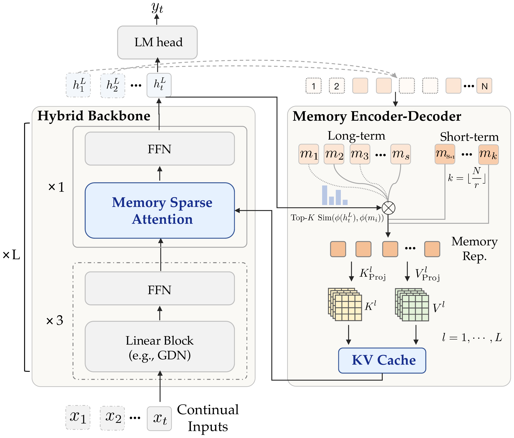
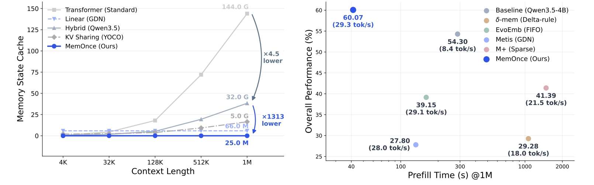
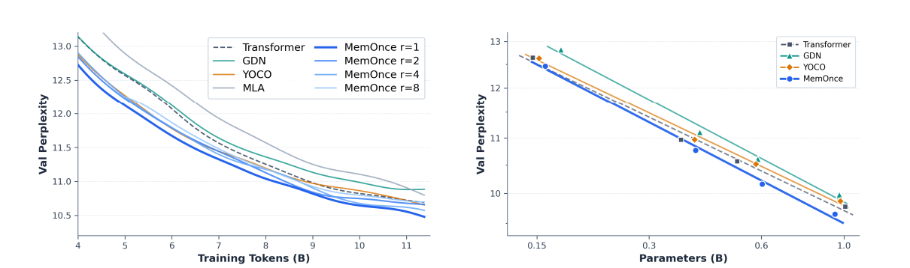
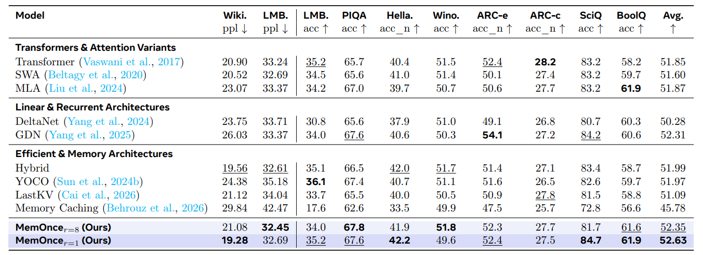
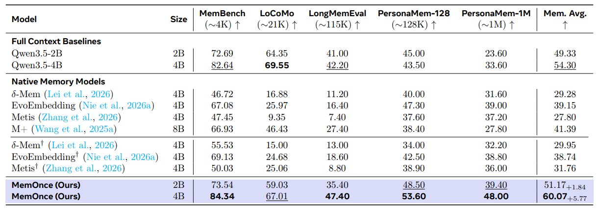
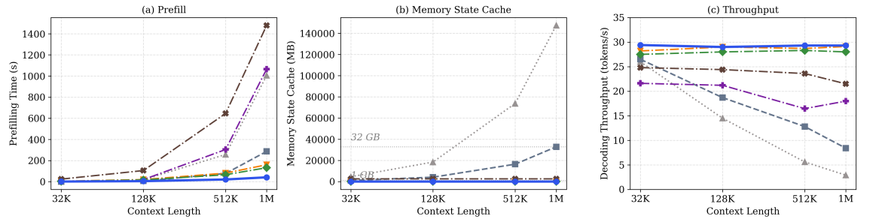

<div align="center">


**A Scalable Memory Architecture for Large Language Models.**

**Chang Nie<sup>1</sup>** · **Chaoyou Fu<sup>1</sup>** · **Songlin Liu<sup>2</sup>** · **Yiqing Hu<sup>2</sup>** · **Caifeng Shan<sup>1</sup>**

<sup>1</sup> Nanjing University &nbsp;·&nbsp; <sup>2</sup> University of Science and Technology of China

<p>
  <a href="https://clare-nie.github.io/MemOnce/"></a>
  <a href="https://arxiv.org/abs/XXXX.XXXXX"></a>
  <a href="https://huggingface.co/ClareNie/MemOnce"></a>
</p>

</div>

## Contents

- 🎨 [Framework](#framework)
- 🏆 [Results](#results)
- 🚀 [Quick Start](#quick-start)
- 📄 [Citation](#citation)

## Framework

Long-horizon interaction requires reusable memory without an ever-growing GPU cache. Transformers retain layer-wise token KV states; recurrent models bound state size but can lose fine-grained detail. MemOnce addresses this trade-off with two coupled designs:

- **Memory encoder-decoder** — cache only a trailing `1/r` subset of final-layer hidden states as compact memory, then decode the selected states back into layer-specific KV caches on demand. This removes the depth factor `L` and compresses the sequence dimension, for an `L r ×` reduction of the persistent cache.
- **Memory sparse attention** — for each new input, retrieve the top-`K` task-relevant memory states **once** and share that routing decision across all attention layers and decoding steps. The persistent bank can grow (and be offloaded to CPU/SSD), while the GPU-resident active state stays constant.

<p align="center">
  <a href="assets/arch.png"></a>
</p>

<p align="center"><em>Figure 1 · The hybrid backbone interleaves three linear blocks with one memory sparse attention block per stage; the memory encoder-decoder compresses history into a small set of final-layer states, then decodes the top-<code>K</code> retrieved states into layer-specific KV caches.</em></p>

The backbone stacks `L` stages, each interleaving three linear blocks (e.g., Gated DeltaNet) with one memory sparse attention block. Writing, indexing and reading are factorized as `G_t = g_θ(x_{1:t-1})`, `M_t = i_θ(x_t, G_t)`, `C_t = u_θ(M_t)`.

| Architecture | State cache | Prefill time |
|---|:---:|:---:|
| Transformer | `O(LND)` | `O(LN²D)` |
| YOCO | `O(ND)` | `O(LN²D)` |
| GDN / SWA / M+ | `O(CLD)` | `O(CLND)` |
| **MemOnce** | **`O(CD)`** | **`O(CLND)`** |

<sub>`L`: depth, `N`: context length, `D`: hidden dim, `C`: a constant active budget (`C ≪ N`). Only MemOnce removes the depth factor while keeping an *expandable* persistent bank.</sub>

MemOnce works as a **foundation architecture trained from scratch** (150M–1B, FineWeb-Edu) and as a **post-training adaptation of frozen Qwen3.5-2B/4B** backbones (~71M trainable parameters). Because the backbone stays frozen during generation and history enters strictly as decoded KV caches, it adds long-range memory without catastrophic forgetting.

> At 1M context on Qwen3.5-4B: **1313× smaller memory state cache** (25 MB vs. 32.05 GB), **6.9× faster prefill** (41.36 s vs. 286.86 s), **3.5× higher decoding throughput** (29.3 vs. 8.4 tok/s), and **+5.77 points** over the full-context baseline on average memory performance.

## Results

<sub>All numbers are from the paper; the figures are the paper's original artwork, stored under [`assets/`](assets/).</sub>

<p align="center">
  <a href="assets/overall_performance.png"></a>
</p>

<p align="center"><em>Figure 2 · Left: the memory state cache stays flat at 25 MB from 4K to 1M tokens, 1313× below the Transformer. Right: overall memory performance vs. prefill time at 1M context — MemOnce sits at the top-left corner.</em></p>

### 1. Foundation capability (pre-training from scratch)

<p align="center">
  <a href="assets/training_curves.png"></a>
</p>

<p align="center"><em>Figure 3 · Left: validation PPL across compression ratios (<code>r = 1, 2, 4, 8</code>) and baselines. Right: scaling from 0.15B to 1.0B parameters — MemOnce gives the best scaling behaviour.</em></p>

<p align="center">
  <a href="assets/foundation_performance.png"></a>
</p>

<p align="center"><em>Figure 4 · Language-modelling and zero-shot reasoning results of the foundation architectures trained from scratch.</em></p>

8× temporal compression costs virtually no accuracy (52.63 → 52.35), while MemOnce beats a 1.4× larger Transformer on downstream reasoning and avoids the long-range PPL degradation of pure recurrent models.

### 2. Long-context memory: 4K to 1M tokens

<p align="center">
  <a href="assets/memory_performance.png"></a>
</p>

<p align="center"><em>Figure 5 · Five memory benchmarks spanning 4K to 1M tokens.</em></p>

<sub>† Re-trained by us under a unified protocol so that all methods share the same data and evaluation harness; unmarked rows report the numbers from the original papers. The `+1.84` / `+5.77` deltas are gains in Mem. Avg. over the corresponding full-context Qwen3.5 baseline. PersonaMem-1M results use a fixed random subset of 500 questions (seed 20261016).</sub>

MemOnce is the first native memory model to surpass the full-context baselines at both 2B and 4B **on the average over the five benchmarks** — LoCoMo is the one benchmark where full context still wins — outperforming M+ by +18.68 and Metis by +32.27 points. Query-conditioned retrieval filters irrelevant history and mitigates attention dilution over ultra-long sequences.

### 3. General capability retention (32K memory load)

| Model | Mechanism | MMLU ↑ | GSM8K ↑ | GPQA ↑ | Gen. Avg. ↑ |
|---|---|:---:|:---:|:---:|:---:|
| Qwen3.5-4B | Full context | 72.81 | **92.00** | 32.83 | 65.88 |
| Qwen3.5-4B (full SFT) | Model weight | 51.97 | 40.50 | 22.73 | 38.40 <sub>−27.48</sub> |
| EvoEmbedding | Soft prompt | 68.64 | 39.50 | **34.85** | 47.66 <sub>−18.22</sub> |
| Metis | Linear state | 71.71 | 23.50 | **34.85** | 43.35 <sub>−22.53</sub> |
| δ-Mem | Linear state | **73.46** | 91.00 | 33.33 | 65.93 <sub>+0.05</sub> |
| **MemOnce** | Decoded KV | 72.59 | 91.00 | 34.34 | **65.98** <sub>+0.10</sub> |

<sub>Deltas are relative to Qwen3.5-4B with full context.</sub>

Soft-prompt and in-backbone-state methods perturb activations and cause severe forgetting; δ-Mem preserves general accuracy but has poor recall (29.28). MemOnce keeps the backbone frozen and attains the best of both.

### 4. Inference efficiency and scalability

<p align="center">
  <a href="assets/inference_scalability.png"></a>
</p>

<p align="center"><em>Figure 6 · Prefill time, memory state cache and decoding throughput from 32K to 1M tokens.</em></p>

| @ 1M context | Prefill ↓ (s) | Decode ↑ (tok/s) | Active GPU cache ↓ | Offloaded pool |
|---|:---:|:---:|:---:|:---:|
| Qwen3.5-4B (full context) | 286.86 | 8.4 | 32.05 GB | — |
| M+ (8B) | 1479.50 | 21.5 | 2.50 GB | 35.90 GB |
| δ-Mem | 1065.88 | 18.0 | 4.5 KB | — |
| EvoEmbedding | 160.33 | 29.1 | 2.6 MB | — |
| Metis | 132.26 | 28.0 | 80.1 MB | — |
| **MemOnce (Ours)** | **41.36** | **29.3** | **25.0 MB** | 640.0 MB |

Prefill grows linearly from 1.38 s (32K) to 41.36 s (1M), and decoding throughput stays near-invariant. Ablations further show: (i) `r = 1 → 8` plus discarding cross-segment linear states costs < 0.3% accuracy; (ii) `K = 64` is the optimal retrieval budget (60.07 avg., `K = 128` drops to 58.86); (iii) single-shot indexing takes **64.24 ms** end-to-end at 128K — **12.0× faster than M+** and **17.0× faster than RAG-Rewrite**.

### 5. Zero-shot transfer to representation tasks

The learned 1024-d memory index descriptors transfer without task-specific fine-tuning:

| Retrieval (8 benchmarks, overall) | R@10 ↑ | N@10 ↑ |
|---|:---:|:---:|
| BGE-M3 (1.2B) | 65.60 | 50.00 |
| Qwen3-Embedding-4B | 62.30 | 48.10 |
| **MemOnce (4B)** | **69.21** | **53.06** |

As a plug-and-play reranker on LoCoMo (top-20 of 256 candidates), MemOnce lifts A-MEM to **60.78 (+17.2)** and LightMem to **53.90 (+13.3)**, above the specialized Qwen3-Reranker-4B (60.39 / 52.40).

## Quick Start

### Installation

A bf16-capable GPU is required (experiments used 8 × NVIDIA H100).

```bash
# Foundation pre-training + zero-shot evaluation
pip install -r requirements/pretraining.txt

# Post-training adaptation + long-context memory benchmarks
# Qwen3.5 requires transformers >= 5.0
pip install -r requirements/posttraining.txt
```

### Download the checkpoint

`model/model.safetensors` contains only the trained parameters — ~71M in total (LoRA `r = 128` write adapter, KV readout projections, `mem_to_emb`); the frozen base Qwen3.5-4B is loaded separately. The checkpoint (264 MB) is served from Hugging Face:

```bash
pip install -U huggingface_hub          # provides the `hf` CLI
hf download ClareNie/MemOnce --local-dir model
```

The frozen Qwen3.5-4B backbone is **not** included — download it from the Qwen release and point `--base-model` at it.

### Inference

```bash
cd test/post-training
export BASE=/path/to/Qwen3.5-4B
export CKPT=../../model

# 1. Strict load check: every trained tensor key must be consumed
python inference.py --base-model "$BASE" --checkpoint "$CKPT" --self-test
# → [self-test] OK: 4 segments, 4 blocks, state=256 tokens, answer='...'

# 2. Built-in multi-hop demo (20 documents + 2 questions)
python inference.py --base-model "$BASE" --checkpoint "$CKPT" --TEXT
# → wrote 20 segments -> 20 memory blocks; retrieved block indices [0, 1, 2, 3]
#   Q1 → Elena Voss / Port Kellen      Q2 → 'Voss blue'

# 3. Batch inference on your own JSONL
python inference.py --base-model "$BASE" --checkpoint "$CKPT" \
    --input my_data.jsonl --output generations.jsonl
```

**Batch input format.** One JSON object per line with a `messages` list. All preceding turns are written into memory (pass documents as individual user turns); the last user turn is the query. Turns longer than 4096 tokens are split into 4096-token segments, one 64-token memory block per segment. Useful flags: `--max-new-tokens`, `--retrieve-blocks`, `--attn-implementation sdpa|flash_attention_2|eager`.

### Repository layout

```text
├── assets/                          # Paper figures used by this README
├── docs/index.html                  # Project page (GitHub Pages)
├── pre-training/                    # Train MemOnce from scratch
│   ├── memonce.py                   #   Self-contained model (torch + fla)
│   ├── train.py                     #   DDP pre-training entry
│   └── eval.py                      #   Validation perplexity
├── post-training/                   # Adapt a frozen Qwen3.5 backbone
│   ├── model.py                     #   MemOnceConfig + MemOnceModel
│   └── train.py                     #   HF Trainer / DDP entry
├── test/
│   ├── pre-training/eval_zeroshot.py    # 8-task lm-eval harness
│   └── post-training/
│       ├── inference.py             #   Load ckpt → write memory → answer
│       ├── bench.py                 #   Unified benchmark runner
│       └── results/                 #   Released generations + judge logs
└── requirements/
    ├── pretraining.txt
    └── posttraining.txt
```

### Pre-training

**Data format.** `pre-training/train.py` / `eval.py` read raw token streams: little-endian `uint16` `.bin` files of token IDs without a header (`vocab_size = 32000` by default). One epoch of the FineWeb-Edu recipe is 21,748 steps × 524,288 tokens ≈ 11.4B tokens.

```bash
cd pre-training

# Smoke test (158M model, 30 steps)
python train.py --size 158m --data train.bin --steps 30 --out ckpt/smoke

# 8-GPU DDP pre-training (945M model), 524,288 tokens per step
torchrun --nproc_per_node=8 train.py --size 945m \
    --data train.bin --val-data val.bin \
    --batch-seqs 1 --grad-accum 16 --out ckpt/memonce_945
```

Supported sizes: `158m`, `397m`, `603m`, `945m` (non-embedding parameters). Defaults: `seq-len = 4096`, `span = 128`, `mem-tokens = 16` (8× compression, `r = 8`), `block-size = 1024`; set `--mem-tokens 128` for the uncompressed `r = 1` variant. Setting `--mem-budget` enables top-`K` retrieval once the compressed history exceeds the attention budget (at the 4096-token pre-training context, the default exact full-memory read is used).

Checkpoints (`stepN.pt`) store `{"model", "model_name", "step", "args"}` so the configuration is rebuilt automatically; resume with `--init-from ckpt/.../stepN.pt --start-step N`.

```bash
# Validation perplexity
python eval.py --ckpt /path/to/step21748.pt --data val.bin

# 8-task zero-shot evaluation (lm-eval)
cd ../test/pre-training
python eval_zeroshot.py --ckpt /path/to/step21748.pt \
    --tokenizer /path/to/llama2_tokenizer
```

`eval.py` and `eval_zeroshot.py` infer model size and memory configuration from the checkpoint weights. `eval_zeroshot.py` reports per-task accuracy plus the `Avg.` headline score.

### Post-training

`post-training/` adapts a **frozen** Qwen3.5-2B / 4B hybrid backbone:

1. **Write** — each dialogue turn or 512-token segment is compressed once into a 64-token memory block (trailing final-layer hidden states), with the memory LoRA adapter enabled.
2. **Index** — blocks are described by a learned `mem_to_emb` projection (`d = 1024`) and retrieved by single-shot cosine similarity (top-`K = 64`); a GPU-resident FIFO keeps the 16 most recent blocks.
3. **Read & generate** — retrieved blocks are decoded into layer-specific KV caches; the backbone generates with the LoRA adapter **disabled**, preserving general capability.

```bash
cd post-training
torchrun --standalone --nproc_per_node=8 train.py \
    --model-name-or-path /path/to/Qwen3.5-4B \
    --dataset-path /path/to/stage1_training_dataset \
    --output-dir output/memonce4b
```

Training data is a directory of `*.json` files, each containing `{"messages": [...]}` ending with an assistant turn. The objective combines next-token prediction on the final assistant response with an InfoNCE contrastive retrieval loss over ground-truth evidence blocks. Recipe: AdamW (`lr = 5e-5`, linear schedule), per-device batch 1 × grad accumulation 4 × 8 GPUs, bf16, gradient checkpointing, `max-length = 32768`, save every 500 steps, `max-steps = 15625` (released checkpoint = step 10000). Use `--resume` or `--init-from` to continue/warm-start.

### Benchmarks

`test/post-training/bench.py` writes each conversation's history into memory once and answers questions strictly from the decoded memory states, graded with each benchmark's official metric or an LLM judge.

```bash
cd test/post-training
python bench.py --help          # full list of --bench choices and data paths

python bench.py --bench membench       --data-dir DIR \
    --base-model "$BASE" --checkpoint "$CKPT" --out membench.json

python bench.py --bench longmemeval   --data-dir DIR \
    --base-model "$BASE" --checkpoint "$CKPT" \
    --judge-url http://JUDGE/v1 --judge-model NAME \
    --out longmemeval.json --gens-out longmemeval.jsonl
```

`--bench` accepts `membench`, `locomo`, `longmemeval`, `personamem128`, `personamem1m` and `msa`. `locomo`, `longmemeval` and `msa` require `--judge-url` / `--judge-model`; `membench` uses option-letter scoring and `personamem128` / `personamem1m` use rule-based ABCD letter matching. `msa` additionally takes `--bank-file`, `--questions-file`, `--budget` and `--msa-f1`. Optional `--max-questions`, `--max-new-tokens`, `--out`, `--gens-out`.

### Verify the release

`model/index.json` records the source SHA-256; verify the release as follows:

```bash
cd model
sha256sum model.safetensors config.json        # Linux
# shasum -a 256 model.safetensors config.json  # macOS
# f5588a7527bc748f686e26f1a76854ca88bd0061f9733505b8cd23703ebfc927  model.safetensors
# b2b56eb6680c2af7f4c1a5fbeef79d99a2ed9ea396ce46a6a8b0f745c047c1bf  config.json
```

Byte-identical weights with greedy decoding reproduce the released generations. Reference generations and judge logs are archived in `test/post-training/results/`.

## Citation

```bibtex
@article{nie2026memonce,
  title   = {MemOnce: A Scalable Memory Architecture for Large Language Models},
  author  = {Nie, Chang and Fu, Chaoyou and Liu, Songlin and Hu, Yiqing and Shan, Caifeng},
  journal = {arXiv preprint},
  year    = {2026}
}
```
